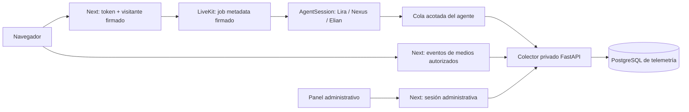

# Telemetría P0: implementación y operación

Rama `feature/telemetry`, PR [#8](https://github.com/sowiroar/Edutech/pull/8),
sobre `backp-fase1` f072455. Mantiene LiveKit/Gemini,
prompts y roles de Jacobo. No modifica assets ni el gitlink Avatar.

## Arranque local

Desde la raíz de **Edutech**:

```sh
python3 scripts/voice_demo.py up
```

`up` genera solo los secretos de telemetría que falten en `.env.voice`; conserva
Google/modelo/portal existentes. También puede ejecutarse por separado:

```sh
python3 scripts/telemetry_setup.py
python3 scripts/voice_demo.py config
```

- Voz: http://localhost:3500
- Panel: http://localhost:3500/admin
- Contraseña: valor `TELEMETRY_ADMIN_PASSWORD` en **tu archivo local `.env.voice`**.
  No pegarlo en chats, commits o capturas. Cada desarrollador genera los suyos.
- PostgreSQL y colector no publican puertos al host. Volumen `telemetry` separado
  de conocimiento/Qdrant. `down` conserva todos los volúmenes.
- Primer arranque prepara RAG en `rag-init`. Puede tardar varios minutos y consumir
  API; no interrumpir/repetir OCR si sigue avanzando. Los siguientes reutilizan índices.

## Flujo y responsabilidades



El colector no está en la ruta síncrona del audio. Fallas de base o HTTP generan
contadores de pérdida, no una excepción en el turno de voz. No hay garantía de
entrega exactamente una vez: sí idempotencia por UUID de evento cuando llega.

| Pieza | Implementación |
|---|---|
| Contrato | `contracts/telemetry-event.v1.schema.json`, generado desde `telemetry-service/src/viva_metrics/contract.py` |
| Persistencia | `telemetry-service/migrations/001_telemetry.sql`, transacción + advisory lock |
| Tablas | telemetry_sessions, telemetry_events, usage_ledger, pricing_rates |
| Productor | `agent-starter-python/src/viva_telemetry/` |
| Uso Google auxiliar | proxy de clientes propios, sin parche global del SDK |
| Identidad/API Next | `agent-starter-react/lib/telemetry/server.ts` y `app/api/` |
| Medios | `lib/telemetry/client.ts`, cola de hasta 50 eventos |
| Panel | `agent-starter-react/app/admin/` |
| CI | trabajo `telemetry` con PostgreSQL efímero y tests de integración |

## Identidad y permisos

Next genera UUID de sesión, conversación, participante y sala. Cookie de visitante
firmada, HttpOnly, SameSite Strict, 30 días. `user_id=null` y
`identity_source=visitor`: esto **no es Moodle ni SSO**. Una sesión conserva la
identidad durante handoff. Mem0 ya no usa `estudiante_uam` como fallback global;
con contexto válido usa visitante opaco, sin contexto usa UUID por sesión.

El contexto de telemetría se firma HS256, audiencia propia y expiración 8 h; viaja
por metadata de dispatch y se comprueba en agente/colector. `/api/token` ignora
user_id y configuración de agentes aportados por el navegador. La ruta de voz
sigue teniendo la restricción explícita de demo que ya tenía Jacobo; no equivale
a autorización institucional para producción.

Panel: contraseña privada, cookie administrativa firmada de 8 h, HttpOnly,
SameSite Strict; POST requiere origen, límite de intentos. GET de métricas y
sesiones exige cookie válida. El colector exige otra clave interna; no exponerlo.
El endpoint público de medios admite solo eventos de medios, ligado al contexto
firmado, con límites de cuerpo/lote/frecuencia. No admite costos, usage, usuario
o UUID de sesión arbitrario. No hay datos sensibles en mensajes de validación.

Límites demo: rate limit en memoria por instancia Next; no RBAC/multitenancy ni
revocación centralizada de sesiones copiadas. Antes de producción: identidad
institucional, HTTPS (`TELEMETRY_COOKIE_SECURE=true`), origen explícito y política
de conservación aprobada. No cambiar esos flags a ciegas en UAM.

## Qué se contabiliza

- Gemini Live: **una** fuente, `session_usage_updated` de LiveKit Agents 1.8.2.
  Es snapshot acumulado; diferencias por proveedor/modelo, repetidos sin cobro,
  reinicio marcado. No sumar además `metrics_collected`.
- Etiqueta SDK `Gemini` normalizada a `google`. Los primeros dos ensayos antes de
  esta corrección conservan costos desconocidos; no se reescribió su historia.
- Totales se particionan en texto/audio/imagen/no especificado y caché. No se suman
  totales a sus desgloses. Discrepancias y residuos permanecen visibles/desconocidos.
- RAG y Mem0: operaciones separadas, llamadas no streaming de clientes Google
  propios interceptadas sin cambiar resultado. Uso disponible del proveedor se
  captura; embeddings sin usage quedan `usage_missing`, nunca tokens inventados.
- Mem0 puede crear hilos internos que no heredan ContextVars. Su cobertura de
  operación se conserva como incompleta incluso si se observaron algunas llamadas.
  No se atribuyen llamadas de otro usuario por una variable global.
- OCR/indexación de prewarm, reintentos internos no expuestos por SDK, llamadas
  fuera de una sesión firmada y uso perdido durante caída no tienen costo completo.
- Uso de Live agregado por sesión/modelo puede no tener request/turn/agent preciso;
  esos IDs no se inventan. Herramientas y speech handles sí conservan su origen,
  incluso cuando su callback llega después de un handoff/cancelación.

Tarifas de lista estándar pagada, verificadas el 17-oct-2026 en
[Google AI pricing](https://ai.google.dev/gemini-api/docs/pricing), USD por millón:

| Modelo | Entrada texto | Entrada audio | Entrada imagen | Salida texto | Salida audio |
|---|---:|---:|---:|---:|---:|
| gemini-3.8-live | 0,75 | 3 | 1 | 4,50 | 12 |
| gemini-2.5-flash (RAG/memoria textual) | 0,30 | — | — | 2,50 | — |
| gemini-embedding-2 (texto) | 0,20 | — | — | — | — |

Caché de texto 2.5 Flash: 0,03. Las demás combinaciones no configuradas quedan
sin tarifa. Ledger usa Decimal y guarda rate_id y costo por entrada. La tarifa
se selecciona por fecha del evento; cambiar precios requiere una nueva revisión
fechada, no editar filas históricas. El subtotal conocido **no es factura**, no
asume plan gratuito/pagado del usuario y excluye GPU/infra/red/impuestos/grounding.

## Eventos, tiempos y cierres

P0: session_started/ended, agent_changed, response_started/completed/interrupted,
tool_started/completed, usage_recorded, error. También operation_started/completed,
producer_health y catálogo de medios para Santiago. `source=collector` solo para
cierre por inactividad (`expired`), rechazado en ingest externo.

Inicio debe existir antes de persistir eventos. Emisor retiene/reenvía su evento
inicial con mismo UUID hasta confirmarlo. Cola 512, lotes 48 (+inicio si hace falta),
HTTP 2 s y tres intentos; apagado drena hasta 3 s. Salud cada 15 s, también en logs:
enqueued/persisted/dropped/write_failed/queue_depth/queue_age_ms. Al apagar a la
fuerza puede perderse la cola: sesión sin actividad se cierra como expirada a los
10 minutos, con evento del colector. No se etiqueta como finalización exitosa.

- `server_response_start_ms`: reloj monotónico, transición SDK a thinking hasta
  creación del speech handle. Null si no hubo límite correlacionable. No TTFT.
- Duración del speech handle: creación a callback done; interrupción es otro tipo.
  No demuestra que el usuario oyó audio ni sincronía labial.
- `browser_first_audio_ms`: estado Connecting a primer `playing` de audio no
  silenciado en esa conexión. No es latencia por turno ni confirmación perceptual.
- `turn_to_playback_ms`: null; requiere marcadores adicionales y control de relojes.
- Percentiles SQL p50/p95 con n y denominador elegible (eventos de respuesta
  o intentos de conexión registrados); sin datos se muestra “Sin dato”. No promedio de
  percentiles. Filtros seleccionan **sesiones iniciadas en el periodo** e incluyen
  todos sus eventos, también los recibidos después. Separación por entorno y modo.

No se guardan audio, transcripciones, prompts ni argumentos/resultados de tools en
telemetría. El sistema previo de memoria/RAG y los logs propios de SDK son sistemas
separados: no confundir esta política con borrado o desactivación de Mem0.

## API para Santiago y Jacobo

- GET `/api/admin/metrics?from=ISO&to=ISO&environment=local&mode=voice`
- GET `/api/admin/sessions` (mismos filtros; cursor UUID, 50 filas)
- GET `/api/admin/sessions/{id}/events?cursor=UUID` (100 filas)
- GET `/api/admin/health`, POST `/api/admin/login`, POST `/api/admin/logout`
- POST `/api/telemetry/media`: `{context_token, events:[...]}`. Cada evento solo
  event_id, occurred_at, type, payload, media_session_id, connection_attempt_id.
  Contexto/source se añaden desde firma, no desde el cliente.

`/api/token` conserva sus cuatro campos originales y añade `telemetry:{context,token}`.
El token no debe imprimirse ni almacenarse en localStorage. El modo predeterminado
es voz; Santiago debe integrar el selector Voz/Avatar validado en servidor,
conservando el mismo contexto/sesión. `agent_id` es rol y `avatar_id` diseño:
seis diseños no crean seis roles. Renderer/UI de avatar siguen fuera de esta entrega.

## Pruebas y colaboración

```sh
cd telemetry-service
uv sync --locked
uv run pytest -q
# Para las pruebas PostgreSQL: TEST_DATABASE_URL apunta SOLO a una base llamada test.
# CI la crea aislada y no usa ninguna clave real.
cd ../agent-starter-python
uv run pytest -q
uv run python ../scripts/test_telemetry_access.py
# La siguiente sí consume API real; audio recibido no se graba:
uv run python ../scripts/test_telemetry_runtime.py --live --scenario handoff --output ../docs/validation/mi-prueba.json
```

Resultados reales y límites: `docs/validation/2026-10-17-telemetry/README.md`.
La prueba de handoff usa texto sintético por `lk.chat`, no micrófono humano.

Trabajar en ramas desde `origin/backp-fase1`, PR a esa base. Esta entrega está en
`feature/telemetry`; Santiago mantiene `feature/avatar-presentation`; Jacobo
`feature/voice-validation`. Antes de actualizar UAM: preservar/publicar allí sus
cambios locales, luego revisar PR/SHA y respaldar datos. **Esta entrega no desplegó UAM**.
No copiar `.env.voice`, volúmenes privados, cachés ni binarios Mac a Windows.
